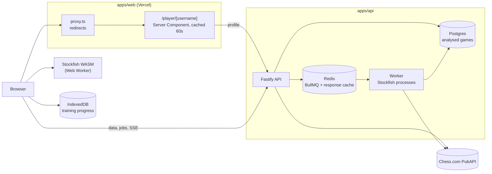

# Architecture

How Daily Gambit is put together. For setup and deployment see the [README](README.md), for the rendering details see [docs/RENDERING.md](docs/RENDERING.md), for the API see [docs/API.md](docs/API.md), and for how each analysis number is produced see [docs/ANALYSIS.md](docs/ANALYSIS.md).

Daily Gambit is an npm workspace with two services and two shared packages:

```
apps/web            Next.js (App Router): the frontend. Pages, Server Components, no database, no route handlers
apps/api            Fastify API and BullMQ worker: all Chess.com access, and the engine analysis
packages/core       the analysis logic and game-record code, plain TypeScript, used by both
packages/contracts  the API's request schemas and response types, used by both
```

**The web app is a pure frontend.** Everything it shows comes from the API over HTTP. It has no database, no route handlers and no Server Actions. **The API owns the data:** it reads Chess.com (with a shared cache), runs Stockfish in a background worker, and stores the analysis in its own Postgres.



The browser also runs Stockfish, but only to check a puzzle answer that is not the engine's first choice (`TrainSection`). Training progress (solved puzzles, streak) is the one thing still stored in the browser.

## Folder structure

```
apps/web/src/
├── proxy.ts                      redirects: /?u=name to /player/name, and /player/Name to the lowercase /player/name
├── app/
│   ├── layout.tsx                header, footer, font (next/font), metadata template
│   ├── page.tsx                  landing page (static)
│   ├── globals.css               all styling
│   └── player/[username]/        page (Server Component, ISR), loading, error, not-found
├── features/player-dashboard/    account overview and the games charts
├── features/analysis/            analysis UI: hub with tabs, game review, puzzles, API client, training storage
├── components/                   small shared UI: Panel, StatCard, Tabs, TableScroll, SectionBoundary, ...
├── lib/api.ts                    the one place that calls the API (address, errors, ?fresh=1)
└── lib/username.ts               the username rule, normalising typed input, shared messages

apps/api/
├── prisma/                       schema and migrations (analysed games)
└── src/
    ├── index.ts, worker.ts       entry points: HTTP server, and a standalone queue worker
    ├── server.ts, bootstrap.ts   building the Fastify app and the shared connections
    ├── config.ts                 environment variables, validated at start-up
    ├── cors.ts, errors.ts        allowed origins (with wildcards), HttpError
    ├── routes/                   health, players (Chess.com data), analysis (jobs, events, results)
    ├── services/                 chessComHttp (cache, single-flight, timeouts), chesscom (typed client), jobs, repo
    ├── queue/                    BullMQ queue, the job processor, the worker
    └── engine/                   Stockfish as a child process over UCI

packages/core/src/                analysis (win chance, classification, mistake types, time, conversion, explorer, puzzles),
                                  game records. Plain TypeScript, 63 tests
packages/contracts/src/           response types for every endpoint, request schemas (Zod)
```

## Server and client

- **Server Components:** the landing page, the player page and `PlayerProfileSection`. The player page asks the API for the profile and renders the card, so the card ships no JavaScript.
- **Client Components:** `PlayerDashboard` and everything below it, `PlayerSearch`, `Avatar`. They hold state and call the API from the browser (CORS allows the web origin).
- The profile card is passed into `PlayerDashboard` as the `profile` prop, so it stays a Server Component inside the client tree.
- `PlayerDashboard` is rendered with `key={username}`, so moving to another player starts from a fresh state.

## Data flow

### Opening a player page

1. `proxy.ts` redirects non-canonical URLs (`/player/Hikaru` to `/player/hikaru`).
2. `page.tsx` calls `getProfile`, which calls `GET /v1/players/:username/profile` with a 60-second Next revalidation. The result is `ok`, `missing` (404, shows `not-found.tsx`) or `unavailable` (the page renders without the profile card). `generateMetadata` uses the same memoized call.
3. The HTML is cached for 60 seconds (ISR). While it renders, `loading.tsx` is shown.
4. In the browser `PlayerDashboard` mounts and loads, in parallel, `stats`, `clubs`, `tournaments`, `matches`, `current-games` and `games` from the API. Each section has its own loading flag; a failure in one does not break the others.
5. Changing the category or period reloads only `games`. The Refresh button reloads everything with `?fresh=1`, which makes the API skip its cache.

Results are tagged with a generation number. If a newer refresh starts, answers from the older one are dropped.

### Searching

`usePlayerSearch` normalises the text, checks the username rule, then calls the profile endpoint. If the player does not exist, or the API or Chess.com is down, it shows the error and the page and URL stay as they are. Otherwise it navigates in a transition, so the current page stays usable.

### Analysing games

1. `usePlayerAnalysis` posts `POST /v1/analysis/jobs` and opens the job's server-sent event stream.
2. The API checks the player exists, applies its limits, and queues the job in Redis (or joins the job already running for the same request).
3. A worker takes the job, asks Chess.com for the newest games, skips games already in Postgres, and runs Stockfish over the rest on several engine processes. Each finished game is stored at once and progress is published.
4. The browser refreshes its list from `GET /v1/players/:username/analysis` as games finish. The tabs (Overview, Openings, Mistakes, Time, Games, Train) are pure functions over those games.

Details, limits and configuration are in [docs/API.md](docs/API.md).

## Caching

| Layer | What | How long |
| --- | --- | --- |
| API, Redis | Chess.com responses, shared by every API process | profile, clubs, tournaments, matches: 5 minutes. Stats, current games, archive list: 1 minute. A month of games (reduced to what the charts need): 6 hours for past months, 1 minute for the current one. "Player not found": 1 minute |
| API, in process | Simultaneous requests for the same thing | one call to Chess.com, shared |
| Next ISR | The `/player/[username]` HTML | 60 seconds |
| React `cache()` | `getProfile` | one render |
| Client router cache | Pages already visited, so Back is instant | managed by Next |

`?fresh=1` skips the Redis cache for that request and replaces the stored answer. A broken Redis never breaks a request: the cache is skipped.

## Error handling

- **API:** one error handler maps everything to a status and a `{ error }` body: 400 for invalid input, 404 when Chess.com has no such player, 502 when Chess.com is down, rate limiting or too slow, 429 and 503 for the daily limit and a full queue, and 500 (with a generic message) for anything else. Every response carries an `x-request-id`.
- **Web:** `lib/api.ts` reads responses defensively (a gateway's HTML error page does not crash it) and throws `ApiRequestError`, which keeps the status. Status 0 means the API could not be reached, which is never reported as "not found".
- **Server rendering:** an API outage degrades the page instead of failing it. `error.tsx` catches anything unexpected, and `SectionBoundary` stops one broken section from replacing the whole page.
- **Chess.com:** a month that cannot be loaded is reported as `missingMonths`, so a partial chart is labelled as partial. If every month fails the request fails instead of showing an empty chart.

## Testing and CI

`npm test` runs the unit tests: 63 in `packages/core`, 14 in `apps/web` (the API helper and the fetchers) and the API's configuration tests. `npm run test:integration` runs the API's 55 tests against real Postgres, Redis and Stockfish. GitHub Actions (`.github/workflows/ci.yml`) starts Postgres and Redis and runs typecheck, both test suites and both builds on every pull request.

## Known gaps

- The web app cannot show anything without the API: it must be deployed and `NEXT_PUBLIC_API_URL` set.
- Training progress (solved puzzles, streak) is stored in the browser, so it does not follow a player between devices. Analysis results do.
- The API has no accounts or authentication. Results are public and keyed by Chess.com username. Limits are per client address only.
- A puzzle answer that is not the engine's first choice is checked by Stockfish running in the browser. It could be an API call instead.
- There are no browser (end to end) tests in the repository. The flows were checked by hand with Playwright against live data and should become automated tests.
- Chess.com responses are typed, not validated at runtime. The game-record code reads fields defensively instead.
- `apps/api/Dockerfile` has not been built in CI or on a machine with Docker.
- With ISR, an unknown player renders the not-found page with status 200 and a `noindex` tag, not a 404.
- Stockfish is GPL-3.0 and is run on the server and served to the browser; the project's licence must be chosen with that in mind.

## Removed in the backend split

- **Puzzle Rush** (chart, snapshots, the daily cron job, the web app's database). Chess.com has no Puzzle Rush history, so the app used to record its own; that is gone. The old data is untouched in the old database.
- **The online dot** on the profile card: Chess.com's `is-online` endpoint no longer exists. The card shows "Last seen" from the profile instead.
- **In-browser game analysis.** The browser fallback needed the web app to fetch games itself. Analysis now always runs on the API.
