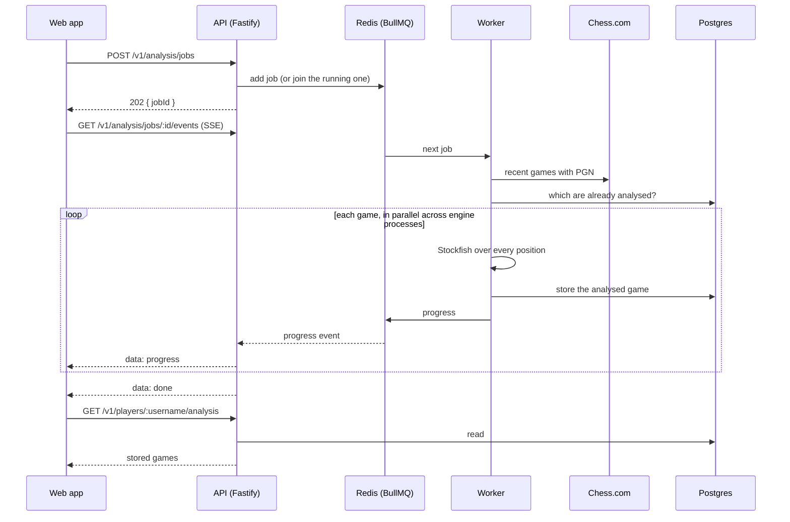

# Analysis API

A Node service (`apps/api`, Fastify and TypeScript). It is the whole backend: it reads a player's Chess.com data (with a shared cache) and runs Stockfish over their games in the background, storing the results. The request and response types are in `packages/contracts`, shared with the web app.

## How it works



## Endpoints

| Method and path | Purpose |
| --- | --- |
| `POST /v1/analysis/jobs` | Queue an analysis. Body: `{ "username": "hikaru", "limit": 25, "timeClass": "blitz" }` (`limit` 1 to 100, default 25; `timeClass` optional: `bullet`, `blitz`, `rapid`, `daily`). Answers `202 { jobId, reused }`. An identical request while one is running joins it (`reused: true`). Limited to 20 per minute per client. |
| `GET /v1/analysis/jobs/:id` | Status: `{ id, username, state, progress, error }`. `state` is `waiting`, `active`, `completed`, `failed` or `cancelled`. |
| `GET /v1/analysis/jobs/:id/events` | Live progress as server-sent events (`status`, `progress`, then `done`, `cancelled` or `error`). The stream ends with the job. |
| `DELETE /v1/analysis/jobs/:id` | Stop a job. A running job stops at its next position. Games already finished are kept. |
| `GET /v1/players/:username/analysis?limit=` | Everything stored for a player, newest game first. |
| `GET /v1/players/:username/profile` | `{ username, profile }`. 404 when Chess.com has no such player. |
| `GET /v1/players/:username/stats` | `{ username, stats }`: ratings and records by game type, as Chess.com returns them. |
| `GET /v1/players/:username/clubs`, `/tournaments`, `/matches`, `/current-games` | `{ username, clubs }`, `{ username, tournaments }`, `{ username, matches }`, `{ username, currentGames }`. |
| `GET /v1/players/:username/games?timeClass=&months=` | The games behind the charts: `{ points, summary, missingMonths }`. `timeClass` is `bullet`, `blitz` (default), `rapid`, `daily` or a variant; `months` is 1 to 36 (default 6). |
| `GET /health` | `200 { status: "ok", database: true, redis: true }`, or `503` when a dependency is down. |

Every `GET /v1/players/...` endpoint accepts `?fresh=1` to skip the cache for that request. Responses carry an `x-request-id` (a sane one sent by the caller is kept).

Errors are always `{ "error": "message" }` with a sensible status: `400` for bad input, `404` for an unknown job or player, `413` for an oversized body, `429` when a limit is reached, `502` when Chess.com is down or too slow, `503` when the queue is full.

`progress` is `{ phase, total, done, inFlight, finishedGameId? }`. `phase` is `fetching`, `analysing` or `done`. `total` is the number of games that still needed analysis. `inFlight` is the progress inside games currently being analysed, in games, which makes a smooth progress bar when several run at once.

## Caching

Chess.com responses are cached in Redis, shared by every API process: profile, clubs, tournaments and matches for 5 minutes; stats, current games and the archive list for 1 minute; a month of games, reduced to what the charts need, for 6 hours (1 minute for the current month); "player not found" for 1 minute. Simultaneous requests for the same thing make one call to Chess.com. Every Chess.com call has an 8-second timeout and is retried once. If Redis is down, requests still work without the cache.

## Protecting the service

There are no accounts, so the limits are by client address (set `TRUST_PROXY=true` only behind a proxy you control, or clients could fake their address):

- **Unknown players are refused before queueing** (404), and "not found" is remembered, so made-up names do not reach Chess.com repeatedly.
- **A daily limit** of new jobs per address (`DAILY_JOB_LIMIT`, default 40) answers 429 with `Retry-After`. Joining a job that is already running is free.
- **A queue cap** (`MAX_QUEUED_JOBS`, default 50): beyond it the API answers 503 with `Retry-After` instead of letting work pile up.
- **Rate limits**: 20 new jobs a minute and 300 requests a minute per address.
- **A 10 KB body limit**, and CORS only for the configured web origins.

## Behaviour worth knowing

- **No repeated work.** Before analysing, the worker asks Postgres which of the player's games are already stored with the current analysis version. Only the rest are analysed. Running the same job twice does no engine work the second time.
- **Parallel.** One job uses `ENGINES_PER_JOB` engine processes (default: up to 4, depending on CPUs) and analyses games across them.
- **Retries.** A job that fails for a passing reason (Chess.com hiccup, engine crash) is retried once. Finished games are already stored, so a retry only does what is left. A player who does not exist fails at once with `Chess.com player not found.`
- **Cancelling.** `DELETE` sets a flag in Redis that the worker checks every half second.
- **Versioned results.** Each stored game carries an analysis version (`SCHEMA_VERSION` in `apps/api/src/services/repo.ts`). Bump it when the analysis changes and old rows are analysed again automatically.

## Running it

```bash
docker compose up -d                     # Postgres and Redis
cp apps/api/.env.example apps/api/.env   # then check the values
npm run db:deploy                        # create the tables
npm run dev:api                          # API on :4000, with the worker inside it
```

Then run the web app (`npm run dev`); it finds the API at `http://localhost:4000`.

### Configuration (`apps/api/.env`)

| Variable | Default | Meaning |
| --- | --- | --- |
| `DATABASE_URL` | required | Postgres |
| `REDIS_URL` | `redis://localhost:6379` | Redis, for the queue |
| `WEB_ORIGIN` | `http://localhost:3000` | Web origins allowed by CORS, comma-separated. `*.` matches any subdomain, for example `https://my-app.vercel.app,https://*.vercel.app` |
| `TRUST_PROXY` | `false` | Trust `X-Forwarded-For` for the client address. Only behind a proxy you control |
| `DAILY_JOB_LIMIT` | `40` | New jobs one address may start per UTC day |
| `MAX_QUEUED_JOBS` | `50` | Jobs allowed to wait in the queue |
| `PORT` | `4000` | |
| `ENGINE_DEPTH` | `12` | Stockfish search depth |
| `ENGINES_PER_JOB` | up to 4 | Engine processes per job |
| `JOB_CONCURRENCY` | `1` | Jobs a worker runs at once |
| `STOCKFISH_PATH` | unset | A native Stockfish binary. Without it the bundled WebAssembly build runs under Node |
| `EMBED_WORKER` | `true` outside production | Run the worker inside the API process |

### Production

Build with `npm run build -w @daily-gambit/api` (or the Dockerfile at `apps/api/Dockerfile`). Run two kinds of process from the same build: `node dist/index.js` (HTTP) and `node dist/worker.js` (queue worker). Start as many workers as you need. Run `npm run db:deploy` on each release.

## Tests

`npm run test:integration` runs 55 tests against real Postgres, Redis and Stockfish: the engine's score convention, storage, the whole job flow with the live event stream, joining and cancelling jobs, failure handling, the Chess.com cache (caching, request collapsing, retries, timeouts, a broken Redis), the games series, every read endpoint, the limits, request ids and CORS. They need `DATABASE_URL` and `REDIS_URL` pointing at a throwaway database (CI provides both).

## Not built yet

- Accounts and authentication. Results are public and keyed by Chess.com username.
- Training progress (solved and failed puzzles, the streak) is still stored in the browser, not on the server.
- Limits are per client address only, which is weak against a determined attacker behind many addresses.
- Puzzle answers that are not the engine's first choice are still checked by Stockfish in the browser; an endpoint for it would be cleaner.
